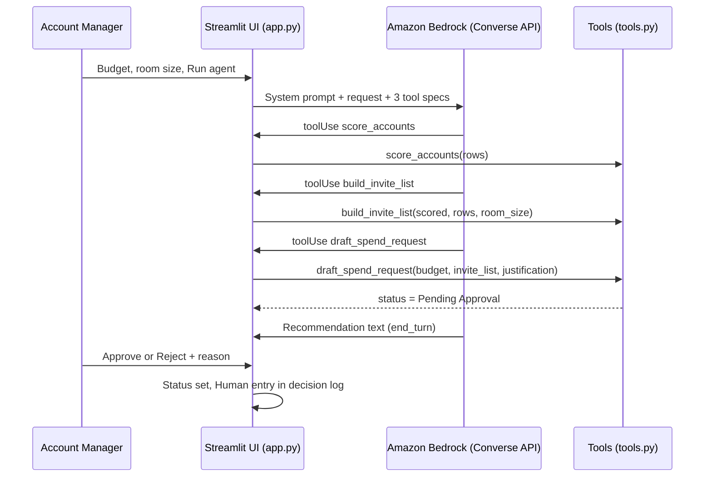

# Royal Table · Account Growth Agent

*Who earns a seat at the Royal table.*

Royal Table helps Royal Cyber **Account Managers** grow existing accounts. It decides which
Tampa Bay financial services executives to invite to an executive event, explains why, and
drafts the event spend request. An Amazon Bedrock agent does the work through three tools.
A person must approve or reject the request. Once a list is approved, Marketing runs the campaign.

> All account signal values in the sample data are illustrative assumptions for a demo,
> not research about real companies.

This repo also contains a separate, browser-only React scoring prototype. See
[React scoring app](#react-scoring-app).

---

## Contents

- [Quick start](#quick-start)
- [How it works](#how-it-works)
- [Scoring rules](#scoring-rules)
- [Configuration](#configuration)
- [Running behind the IDE proxy](#running-behind-the-ide-proxy)
- [Testing](#testing)
- [Project layout](#project-layout)
- [MCP servers (optional)](#mcp-servers-optional)
- [Troubleshooting](#troubleshooting)
- [React scoring app](#react-scoring-app)

---

## Quick start

Requirements: Python 3.11 or later, AWS credentials that can call Bedrock, and a Bedrock model
that supports tool use.

```bash
python3 -m venv .venv
.venv/bin/pip install -r requirements.txt

export BEDROCK_MODEL_ID=us.anthropic.claude-haiku-4-5-20251001-v1:0
export AWS_REGION=us-east-1
.venv/bin/streamlit run app.py
```

Open the URL that Streamlit prints, then:

1. **Set the table.** Enter the budget (default $25,000) and room size (default 40 executives).
2. Click **Run agent**. The agent scores every account, fills the seats and drafts a spend request.
3. Review the **Decision board**, the spend request and the agent's recommendation.
4. **Confirm the table.** Enter a reason and click **Approve** or **Reject**.

## How it works



**Guardrails**

- **Numbers come only from tools.** The model supplies small arguments only (`room_size`,
  `budget`, `justification`). The app passes the account data to each tool from session state.
  It also overrides `room_size` and `budget` with the values in the UI, so the model can't change them.
- **Only a person changes the status.** `draft_spend_request` always returns `Pending Approval`.
  Approve and Reject are UI handlers, not tools, so the agent can't call them. Both require a reason.
- **The run is bounded.** The loop stops after 6 model turns. A run counts only if the agent called
  `draft_spend_request`. Otherwise the app shows "Agent did not draft a spend request".
- **No hard-coded keys.** boto3 uses the standard AWS credential chain.

**The three tools** (`tools.py`, pure functions with no Streamlit or boto3 imports)

| Tool | Input from the model | Returns |
|---|---|---|
| `score_accounts` | nothing | company, score, tier, badge, reason, reason codes and the highly recommended flag, sorted by score |
| `build_invite_list` | `room_size` | Invite tier accounts in score order until the next one would exceed the room, plus the executive count |
| `draft_spend_request` | `budget`, `justification` | invited accounts, executive count, cost per executive, status `Pending Approval` |

## Scoring rules

**Points per signal**

| Signal | Points |
|---|---|
| `local_decision_authority` | Yes 3 · Partial 2 · No 0 |
| `offering_fit`, `deal_size_fit`, `persona_confidence` | High 3 · Medium 2 · Low 1 · blank 0 |
| `relationship_warmth` | Warm 3 · Known 2 · Cold 0 |
| `trigger_signals` | number of semicolon-separated items, capped at 3 |

**Weights (fixed):** authority 20, offering fit 25, triggers 20, deal size 15, warmth 10,
persona confidence 10.

**Score** = sum of (weight × points ÷ 3), rounded half up to a whole number from 0 to 100.

| Result | Rule |
|---|---|
| Invite | score 70 or above |
| Nurture | 40 to 69 |
| Deprioritize | below 40 |
| ⭐ Highly recommended ("head of the table") | Invite tier and score 90 or above. This is a label only and changes nothing else |
| Movement badge | `current_tier` Tier 1 / 2 / 3 maps to Invite / Nurture / Deprioritize and is compared with the new tier: Moved up, Moved down or No change |
| Executives | each semicolon-separated title in `target_persona` is one seat |
| Cost per executive | budget ÷ executives, rounded half up to the nearest dollar |

**Reasons.** Each account gets a one-sentence reason built from its two highest-scoring signals,
in executive language, for example "the buying decision is made locally in Tampa". It also gets
**reason codes**: short labels such as *Local decision maker (Tampa)*, *C-suite in the room*,
*New CDO in first 100 days*, *Regulator deadline* and *Warm executive relationship*. Codes come
only from the CSV and never change scores.

**With the sample data and defaults:** 7 Invite accounts and 14 executives, at $1,786 per
executive. Four accounts are highly recommended: Suncoast Credit Union (100), BayFirst Financial
(97), Raymond James (92) and GTE Financial (90).

## Configuration

| Setting | Where | Notes |
|---|---|---|
| `BEDROCK_MODEL_ID` | environment variable, required | Any Bedrock model or inference profile with tool use. Tested: `us.anthropic.claude-haiku-4-5-20251001-v1:0`, `us.anthropic.claude-sonnet-4-5-20250929-v1:0`, `us.amazon.nova-pro-v1:0` |
| `AWS_REGION` | environment variable, required | For example `us-east-1` |
| AWS credentials | standard AWS chain | Instance role, SSO, profile or environment variables. Never put keys in code |
| Brand colours | `BRAND` in `app.py` | From the royalcyber.com theme: navy `#003963`, orange `#E66208` |
| Logo | `assets/royal_cyber_logo.svg` | Official logo from royalcyber.com |
| Data | `data/tampa_target_accounts.csv` | Read-only. Must stay identical to `public/sample/tampa_target_accounts.csv` |

If `BEDROCK_MODEL_ID` or `AWS_REGION` is missing, the app shows an error naming the variable and
makes no Bedrock call.

## Running behind the IDE proxy

In the workshop IDE, the browser reaches the app only through the CloudFront proxy, and only via
the Vite dev server on port 5173. `vite.config.ts` forwards `/absproxy/5173/curator` to Streamlit
on port 8501, including websockets.

```bash
# Terminal 1: the Vite dev server (also serves the React app)
npm run dev

# Terminal 2: Royal Table
export BEDROCK_MODEL_ID=us.anthropic.claude-haiku-4-5-20251001-v1:0 AWS_REGION=us-east-1
.venv/bin/streamlit run app.py --server.port 8501 --server.address 127.0.0.1 \
  --server.headless true --server.baseUrlPath absproxy/5173/curator \
  --server.enableCORS false --server.enableXsrfProtection false
```

| App | URL (trailing slash required) |
|---|---|
| Royal Table | https://<your-cloudfront-host>/absproxy/5173/curator/ |
| React scoring app | https://<your-cloudfront-host>/absproxy/5173/ |

The URL path keeps the earlier name, `curator`. Turning off CORS and XSRF protection is needed
because requests arrive under the CloudFront host. It's acceptable behind the IDE login, but not
for a public deployment. No extra ports need opening.

## Testing

**Unit tests** (scoring, invite list, cost per executive):

```bash
.venv/bin/pytest
```

**Browser tests** (Playwright, real Bedrock, about 30 seconds):

```bash
.venv/bin/pip install -r requirements-dev.txt
.venv/bin/playwright install chromium
BEDROCK_MODEL_ID=us.anthropic.claude-haiku-4-5-20251001-v1:0 AWS_REGION=us-east-1 \
  .venv/bin/pytest --screenshot only-on-failure --output test-results
```

- The browser tests start their own Streamlit on port 8599, and skip when `BEDROCK_MODEL_ID` is not set.
- They check the header logo position, the decision board (20 / 7 / 4 / 14 of 40), the spend
  request (14 executives, $1,786), the empty-reason error, and the Approve and Reject flows.
  They assert tool numbers only, never the agent's wording.
- Full-page screenshots are saved to `test-results/`.
- On Amazon Linux 2023, `playwright install --with-deps` is not supported. Install Chromium's
  libraries with `dnf` instead: `libatomic nss nspr atk at-spi2-atk cups-libs libdrm libxkbcommon
  libXcomposite libXdamage libXrandr mesa-libgbm pango alsa-lib`, plus
  `google-noto-emoji-color-fonts` for emoji.

## Project layout

```
app.py                          Streamlit UI, Bedrock agent loop, session state, approval and log
tools.py                        score_accounts, build_invite_list, draft_spend_request (pure functions)
test_tools.py                   Unit tests (pytest)
test_e2e.py                     Browser tests (Playwright, real Bedrock)
requirements.txt                streamlit, boto3, pytest
requirements-dev.txt            + pytest-playwright
data/tampa_target_accounts.csv  Sample accounts (20 rows, titles only, no names)
assets/royal_cyber_logo.svg     Royal Cyber logo
vite.config.ts                  Vite dev server, IDE proxy settings, /curator proxy to Streamlit
src/, public/, index.html       React scoring app
.kiro/specs/target-curator-agent/  Requirements, design and tasks for Royal Table
.kiro/steering/                 Kiro steering: product, tech, structure, code style, git workflow, feature spec
.kiro/agents/                   orchestrator, spec, build, reviewer agents (see docs/ai-dlc-agents.md)
```

**Session state** (all in memory, nothing saved between sessions): `rows`, `scored`,
`invite_list`, `tool_calls`, `agent_summary`, `request`, `log`, `error`. Clicking **Run agent**
clears everything except the loaded rows.

## Logging and security

**Logs.** `app.py` writes one JSON line per event to stderr, which is the Streamlit terminal.
Set `LOG_LEVEL=DEBUG` for more detail.

| Event | Fields |
|---|---|
| `run_start` | run_id, model, budget, room_size |
| `bedrock_call` | run_id, turn, stop_reason, latency_ms, wall_ms, input_tokens, output_tokens |
| `tool_call` | run_id, tool, status, ms, the model's arguments (justification left out), error |
| `run_end` | run_id, outcome, turns, ms, accounts, executives, cost_per_executive, total tokens |
| `config_error`, `bedrock_error`, `run_failed` | what failed (`run_failed` includes the stack trace) |
| `decision`, `decision_rejected_empty_reason` | status, and the reason's length only |

Logs never contain credentials, prompts or full tool outputs. To search them:
`... streamlit run app.py 2>&1 | tee royal-table.log`, then `grep '"run_end"' royal-table.log`.

**Bedrock metrics** (invocations, latency, throttles, errors) are already in CloudWatch under
`AWS/Bedrock`, with no setup needed.

**Security scans:** `bash scripts/security-scan.sh` runs pip-audit, bandit, npm audit and
detect-secrets through `uvx`, so no project dependencies are added. It exits non-zero on any finding.
The Kiro hook `.kiro/hooks/security-scan.json` runs the same script whenever `app.py`, `tools.py`,
a `requirements*.txt` file or `package.json` is saved. It's a shell command, so it uses no Kiro credits.

**Hardening in place**
- Every CSV value rendered as HTML is escaped with `html.escape`.
- Dependencies are pinned to the tested versions.
- There are no keys in code.
- Only a person can change the request status.

**Known gap:** CORS and XSRF protection are off for the IDE proxy (see above).

## MCP servers (optional)

For development with Kiro, two MCP servers have been tested against this project. Add them to
`.kiro/settings/mcp.json` yourself, because Kiro's permission rules don't let the agent write that folder.

- **Playwright MCP:** lets Kiro open the local app, click through it and take screenshots.
- **AWS Pricing MCP:** live AWS prices, for example to compare model costs per run.

```json
{
  "mcpServers": {
    "playwright": {
      "command": "npx",
      "args": [
        "-y", "@playwright/mcp@latest", "--headless", "--isolated",
        "--executable-path", "/home/participant/.cache/ms-playwright/chromium-1255/chrome-linux64/chrome",
        "--viewport-size", "1366x900",
        "--allowed-origins", "http://127.0.0.1:8501;http://127.0.0.1:5173;http://localhost:8501;http://localhost:5173",
        "--output-dir", ".playwright-mcp"
      ],
      "disabled": false,
      "autoApprove": []
    },
    "awslabs.aws-pricing-mcp-server": {
      "command": "uvx",
      "args": ["awslabs.aws-pricing-mcp-server@latest"],
      "env": { "FASTMCP_LOG_LEVEL": "ERROR", "AWS_REGION": "us-east-1" },
      "disabled": false,
      "autoApprove": []
    }
  }
}
```

- `--executable-path` reuses the Chromium installed for the browser tests. Change the path if
  your Playwright version differs.
- `AWS_PROFILE` is left out on purpose. On an instance role, a missing `default` profile breaks authentication.
- Use the local URL (`http://127.0.0.1:8501/absproxy/5173/curator/`) with Playwright MCP, because
  the CloudFront URL needs your login.

## Troubleshooting

| Symptom | Cause and fix |
|---|---|
| HTTP 502 at `/curator/` | Streamlit isn't running on 8501. Start it with the command above |
| "Blocked request. This host is not allowed" | Vite's `allowedHosts` doesn't include the proxy host. See `vite.config.ts` |
| Blank page or broken assets on the React app | Open `/absproxy/5173/` with the trailing slash, and restart Vite after config changes |
| "Environment variable BEDROCK_MODEL_ID is not set." | Export `BEDROCK_MODEL_ID` and `AWS_REGION` before starting Streamlit |
| "Bedrock call failed: …AccessDenied…" | The credentials can't invoke that model. Try another tested model ID |
| Agent summary longer than three sentences | Known with Haiku 4.5, which ignores that part of the prompt. Sonnet 4.5 is more likely to follow it |
| Logo hidden under the top toolbar | `.block-container` top padding in `app.py` must stay at 4.5rem or more |

## React scoring app

A browser-only prototype of account readiness scoring, built with React 19, TypeScript and Vite.
It has no backend and no AI calls. Its spec is in
`.kiro/steering/feature-account-readiness-scoring.md`. So far only the scoring logic exists
(`src/scoring.ts`, tested in `src/scoring.test.ts`). The UI is still the Vite template.

```bash
npm install
npm run dev      # http://localhost:5173/absproxy/5173/
npm test         # Vitest
npm run build
npm run lint
```
