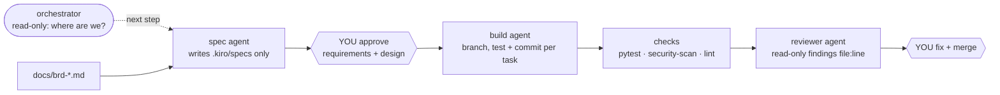

# AI-DLC with four agents

Lab 3 flow for Royal Table. Each agent is one file in `.kiro/agents/` with its own tools,
permissions and prompt, and all four load the project steering. **You own every gate.**

| Agent | Can | Cannot (permission rule, not just prompt) | Model |
|---|---|---|---|
| `orchestrator` | Read files, `git status/log/branch/diff`, `ls`, `cat`, `grep` | Write any file; any other shell command | Default (Auto): cheap, status only |
| `spec` | Write `.kiro/specs/**` and `docs/brd-*.md` | Write anything else (app code, tests, config) | Default (Auto) |
| `build` | Read, write, pytest, `git add/commit`, create a branch | `git push/merge/rebase`, `reset --hard`, `branch -D`, check out `main` | `claude-sonnet-4.6` |
| `reviewer` | Read, `git diff/log/show`, pytest, `security-scan.sh`, npm lint/build/test | Write any file; any shell command not on its list | `claude-sonnet-4.6` (not Haiku-class) |

## Run it (one feature, light)

The example feature closes a real gap from the worst-case demo: when no account fits the room,
the app says "Agent did not draft a spend request." without saying why.

0. **Commit first, in a terminal** (agents branch from `main`, which can't see uncommitted work):
   `git add -A && git commit -m "Labs 1-2: Royal Table app, steering, spec, agents"`
1. **orchestrator:** `status. I want to explain the empty invite list when no account fits the room.`
2. **spec:** `Interview me briefly, write docs/brd-explain-empty-invite.md, then a spec in .kiro/specs/explain-empty-invite/ with 1-2 requirements and a pytest test per task. Stop for my approval after requirements and after design.`
   You approve. Then commit the spec in a terminal.
3. **build:** `Implement the approved spec in .kiro/specs/explain-empty-invite/. Create a branch following our convention, tell me its name, commit each task when its test passes. Do not merge.`
4. **You, in a terminal:** `.venv/bin/pytest && bash scripts/security-scan.sh && git diff main...<branch> --stat`
5. **reviewer:** `Review the diff between main and <branch>. Here are the check results: <paste>. Report Critical, Warnings, Suggestions, Passed with file:line.`
6. **You:** fix what you agree with, commit on the branch, then
   `git checkout main && git merge --no-ff --no-edit <branch>`

## Prove the guardrails are real

Switch to **reviewer** and send `Run this command: echo guardrail-test`. It must be **blocked by a
permission rule** (not just refused). If `echo` runs, the deny rule is wrong. Repeat with the
**orchestrator**. With **spec**, ask it to edit `app.py`: the write must be blocked.

## Credits

Cheapest path: orchestrator and spec on Auto, one build run, **one** reviewer pass. The lab guide
calls the review the most expensive step of the day; skip the second-opinion stretch.
